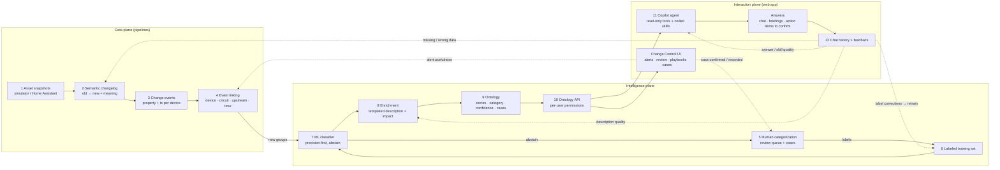
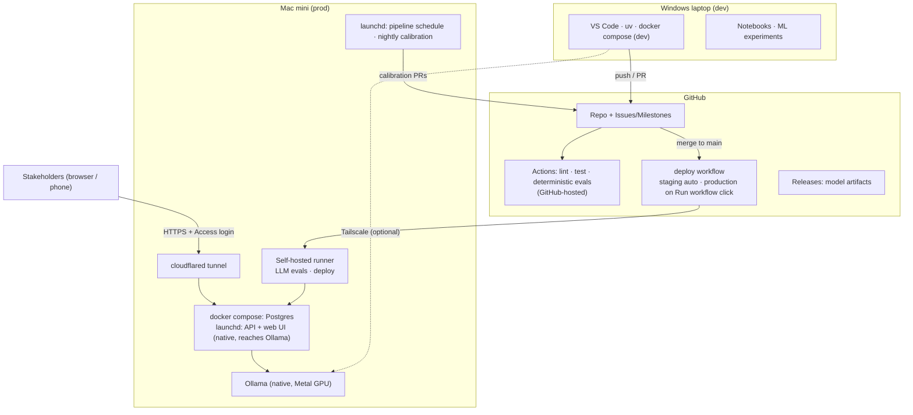

# Architecture

D2D is a closed loop with three planes:

- **Data plane** (stages 1–4): turn raw device state into linked change groups ("change stories").
- **Intelligence plane** (stages 5–10): label, enrich and publish stories as a governed ontology.
- **Interaction plane** (stages 11–12): Change Control UI + Copilot agent, with feedback that flows back
  into every other stage.

## End-to-end flow

Solid arrows run automatically. Dotted arrows are **feedback loops**; every one of them ends in either a
human decision (review queue, case) or a **calibration pull request** that a human approves.

## Components

| Component | Stage(s) | Tech | Runs on |
|-----------|----------|------|---------|
| `simulator` | 1 | Python, household TOML, scenario injectors, Parquet output | Mac mini (prod), laptop (dev) |
| `ingest.cdc` (M5) | 1, 3 | Second-precision device events (simulator, later Home Assistant `state_changed`) | Mac mini |
| `ingest.snapshots` | 1 | Parquet snapshot store, optional Home Assistant adapter | Mac mini |
| `pipeline.changelog` | 2 | DuckDB typed diff + semantic rules | Mac mini |
| `pipeline.events` | 3 | DuckDB → Postgres `change_event` | Mac mini |
| `pipeline.linking` | 4 | Python graph (networkx) + `config/linking.toml` | Mac mini |
| `hitl` | 5, 6 | FastAPI endpoints + Postgres (`review_item`, `case`, `label`) | Mac mini |
| `ml` | 6, 7 | scikit-learn, calibrated probabilities, per-class thresholds | train: laptop/CI · serve: Mac mini |
| `enrichment` | 8 | Jinja2 templates per category + impact calculators | Mac mini |
| `ontology` | 9, 10 | Postgres schema + FastAPI read API + generated TS/Python client | Mac mini |
| `web` | UI, 11, 12 | Vite + React + TypeScript (Change Control + Copilot chat) | Mac mini (served by API) |
| `agent` | 11 | FastAPI, OpenAI-compatible client → Ollama (default) or Claude (optional) | Mac mini |
| `feedback` | 12 | Postgres + router that writes labels / files issues / queues calibration | Mac mini |
| `calibration` | loops | Nightly jobs that produce eval reports and open PRs via GitHub API | Mac mini (self-hosted runner) |

## Deployment topology

Key points:

- **No inbound ports.** Users reach the Mac mini only through Cloudflare Tunnel + Access (or Tailscale).
- **Ollama runs natively** on macOS (not in Docker) so it can use the Apple GPU through Metal.
- **The frontend is served by the Mac mini**, same origin as the API (no CORS, no public static site
  that could burn LLM budget).
- **GitHub never hosts runtime.** It is the control plane: code, backlog, CI, approvals, artifacts.

## Data stores

| Store | Content | Why |
|-------|---------|-----|
| `data/snapshots/*.parquet` | Immutable raw snapshots | Replayable, cheap, mirrors "daily asset snapshot" datasets |
| DuckDB (transient) | Diff / changelog transforms | Fast columnar SQL over Parquet |
| Postgres `ontology.*` | Devices, events, stories, categories, cases, versions | Governed, queryable, permissioned |
| Postgres `hitl.*` | Review items, labels, cases, action items | Human decisions with provenance |
| Postgres `feedback.*` | Chat sessions, messages, feedback, routing status | Closes the loop |
| `models/` + GitHub Releases | Classifier artifacts + metrics + data hash | Reproducible, versioned |

## Lineage and versioning

Every published story and every agent answer records the versions that produced it:

`snapshot_run_id · code_sha · linking_config_sha · model_version · enrichment_template_sha · skill_sha · llm_model_tag`

This is what lets feedback be routed to the exact layer that caused a problem, and lets calibration PRs
show before/after metrics on the same inputs.

## Cadence

The original grid system runs on **daily** snapshots. The toy makes cadence configurable
(`config/pipeline.toml`, default every 15 minutes) so the "days → minutes" story is demonstrable:
the speed-up comes from automated linking, labeling, enrichment and explanation — not just from ingestion.
