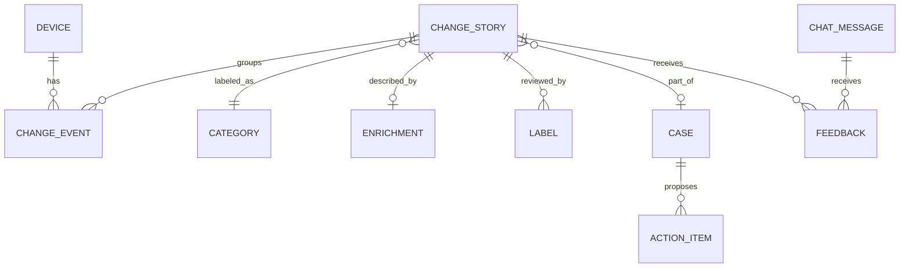

# Domain model

## Grid ↔ smart-home mapping

The toy domain is a smart home, chosen because it has the same *shape* as grid operations: assets with
configuration and operational state, a topology (asset → circuit → upstream equipment), policy zones,
and external drivers (weather, demand response).

| Grid concept | Smart-home equivalent | Example |
|--------------|-----------------------|---------|
| Asset (device, PRIOH, …) | Device | `dishwasher`, `robot_vacuum`, `ev_charger` |
| Circuit | Breaker circuit | `circuit_kitchen_2` |
| Upstream equipment | Panel / Zigbee hub / Wi-Fi router | `panel_main`, `hub_zigbee`, `router_mesh_1` |
| High-risk zone / buffer | Policy zone | `quiet_hours`, `peak_tariff`, `away_mode` |
| MET / weather polygon | Weather + demand-response window | heat wave, utility DR event |
| Daily asset snapshot | Periodic device snapshot | every 15 min (configurable) |
| Change Control case | Case | "EV charger moved to garage circuit" |
| Switch / breaker operation | Light switch on/off, garage door open/close | `garage_door` opened at 02:10 while `away_mode` |
| Physical-security alarm | Ring camera motion / person detected | `ring_camera_front` person detected |
| Customer call / trouble report | Ring doorbell ring | missed visitor at the front door |

Fast-changing devices (cameras, doorbells, switches, garage door) are captured as a **CDC event
stream** in addition to snapshots; see [roadmap M5](feature-roadmap.md#m5--event-native-devices-and-notifications).

## Household configuration

`config/household.toml` declares the static topology. Example:

```toml
[home]
id = "home_demo"
timezone = "America/Los_Angeles"

[[upstream]]
id = "panel_main"
kind = "panel"

[[upstream]]
id = "hub_zigbee"
kind = "hub"

[[circuit]]
id = "circuit_kitchen_2"
panel = "panel_main"
rating_amps = 20

[[device]]
id = "dishwasher"
kind = "dishwasher"
room = "kitchen"
circuit = "circuit_kitchen_2"
network = "router_mesh_1"
```

## Device snapshot schema (stage 1)

One row per device per snapshot run, stored as Parquet under `data/snapshots/run_ts=…/`.

| Column | Type | Notes |
|--------|------|-------|
| `snapshot_run_id` | string | `run_YYYYMMDDTHHMMSSZ` (deterministic, see [ADR 0001](adr/0001-deterministic-simulator.md)) |
| `snapshot_ts` | timestamp | UTC |
| `device_id` | string | |
| `kind` | string | appliance type |
| `room`, `circuit_id`, `upstream_ids` | string / list | topology at snapshot time |
| `firmware_version` | string | configuration |
| `schedule` | JSON | configured run windows |
| `settings` | JSON | safety settings (child lock, max temp, ...) |
| `reported_ts` | timestamp | device clock (clock-skew data-quality rule) |
| `mode`, `setpoint` | string / float | configuration |
| `power_w`, `energy_kwh_total` | float | operational |
| `state` | string | `idle`, `running`, `error`, `offline` |
| `error_code` | string? | operational |
| `rssi_dbm`, `network_id` | int / string | connectivity |
| `source` | string | `simulator`, `home_assistant` |

## CDC event stream (stage 1, event-native devices, M5)

One row per device property change, at second precision, under `data/cdc/`. Same shape as a
change event and as Home Assistant `state_changed` (old and new state), so the real adapter keeps
the schema. Momentary signals are pulses (`idle → pressed → idle`).

| Column | Example |
|--------|---------|
| `device_id` | `garage_door` |
| `property` | `door`, `power`, `motion`, `person`, `button`, `call`, `battery`, `presence` |
| `old_value` → `new_value` | `closed` → `open`, `off` → `on`, `idle` → `pressed` |
| `event_ts` | `2026-10-02T09:10:42Z` |
| `source` | `remote`, `app`, `button`, `automation`, `manual`, `device` |

Routine CDC events are not emitted as change events. Context rules (duration, policy zone,
sequence) turn them into meaningful changes such as `garage_left_open`, `motion_while_away`,
`missed_visitor`.

## Semantic changelog (stage 2)

Typed diff of consecutive snapshots per device. Each row adds *meaning* from `config/semantics.toml`:

| Column | Example |
|--------|---------|
| `device_id` | `dishwasher` |
| `property` | `schedule.start` |
| `old_value` → `new_value` | `18:00` → `02:00` |
| `change_kind` | `config` / `operational` / `topology` / `data_quality` |
| `semantic_tag` | `schedule_shift_off_peak` |
| `snapshot_ts_before`, `snapshot_ts_after` | |

Data-quality rules (stage 2) flag impossible values: negative energy deltas, clock jumps, duplicate
device IDs, unit changes. These become `data_quality` changes and feed the **data error** category.

## Change event (stage 3)

`ontology.change_event(event_id, device_id, property, old_value, new_value, change_kind, semantic_tag,
event_ts, snapshot_run_id)` — one row per changelog row, idempotent on `(device_id, property, event_ts)`.

## Event linking → change story (stage 4)

Events are nodes; edges are added when two events share:

- the same device within `device_window` (default 60 min), or
- the same circuit / upstream equipment within `topology_window` (default 30 min), or
- the same automation or firmware version within `campaign_window` (default 24 h), or
- the same policy-zone / weather window.

Connected components become **change groups** (`ontology.change_story`). Weights and windows live in
`config/linking.toml` and are a calibration target. Linking quality is measured against scenario
ground truth with pairwise precision/recall and Adjusted Rand Index.

## Category taxonomy (stage 5, human-owned)

Defined in `config/categories.toml`; each category has a definition, examples and a **playbook**
(recommended checks and actions) used by the Copilot.

| Category | Grid analogue | Typical signal |
|----------|---------------|----------------|
| `firmware_rollout` | Equipment upgrade campaign | Same firmware change across many devices within a day |
| `load_shift` | Load transfer | Schedules moved out of the peak-tariff window |
| `circuit_reassignment` | Sectionalize | Device circuit/plug changes, power reappears elsewhere |
| `device_replacement` | Underground conversion | Device removed + same-kind device added in same room |
| `network_change` | Communications change | Router/hub change; many devices switch `network_id` / RSSI |
| `weather_dr_response` | MET / weather event | Setpoints and schedules change during a heat wave or DR window |
| `safety_setting_change` | Protection setting change | Child lock, max temp, auto-off timers changed |
| `fault_degradation` | Equipment failure | Error codes, rising runtime per cycle, repeated offline |
| `data_error` | Data error | Impossible values, clock jumps, duplicates |
| `device_added_removed` | New service / retirement | Device appears or disappears without a matching replacement |
| `security_event` | Intrusion / CCTV alarm | Motion or person detected while `away_mode` or in `quiet_hours` |
| `access_left_open` | Abnormal switching state | Garage / door open longer than the configured threshold |
| `visitor_activity` | Customer call | Doorbell ring + person detected; missed visitor; package delivery |
| `lighting_change` | Switching plan change | Light automation changed; lights left on while away |
| `abstain` | — | Classifier below per-class threshold → human review |

## Ontology (stage 9)



Key fields on `change_story`: `story_id, home_id, window_start, window_end, device_ids, event_count,
category, confidence, label_source (model|human), status (new|needs_review|published|closed),
model_version, linking_config_sha, enrichment_template_sha`.

## Roles and permissions (stage 10)

| Role | Sees | Can do |
|------|------|--------|
| `owner` | everything | review, label, open/close cases, approve action items |
| `family` | all devices except those tagged `private` | chat, feedback |
| `energy_advisor` | energy/load categories only, no room names | chat, feedback, propose action items |
| `guest` | published stories for shared rooms | chat |

Permissions are enforced in the API layer (row filters on `home_id`, device tags and categories), so the
Copilot can only see what the asking user can see.

## Scenario injectors (ground truth)

The simulator plants labeled scenarios so every stage can be scored:

`firmware_rollout`, `load_shift_to_off_peak`, `ev_charger_moved_circuit`, `dishwasher_replaced`,
`router_swap`, `heat_wave_dr`, `child_lock_disabled`, `washer_bearing_degradation`, `clock_drift`,
`duplicate_device`, `new_smart_plug`, `meter_reset`, plus background noise (normal runs, RSSI jitter).

Each injection writes `data/ground_truth/*.jsonl` with `scenario_id, category, event keys, start, end`.
