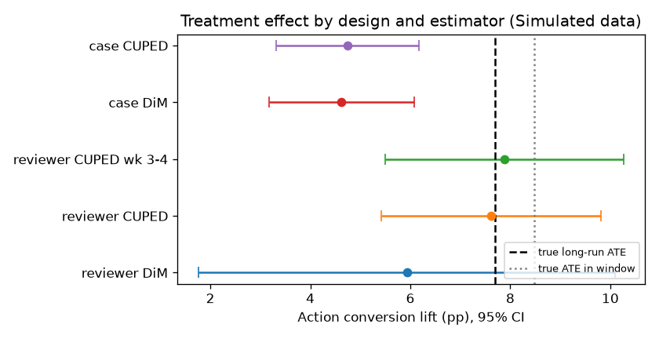
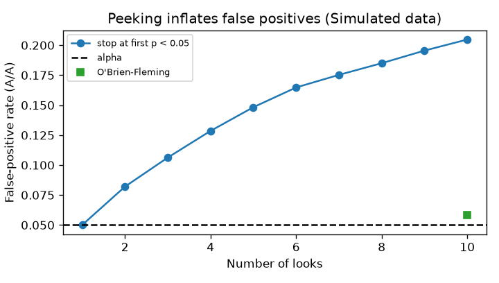
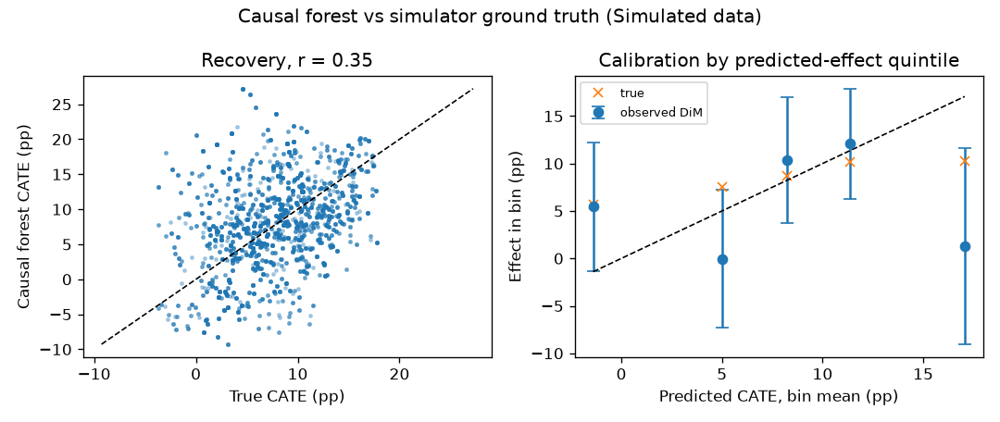
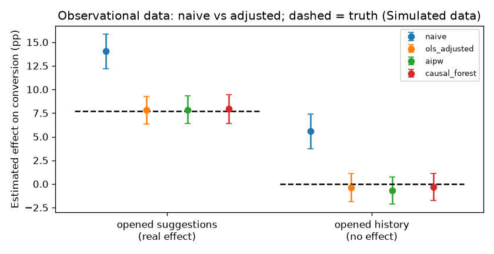
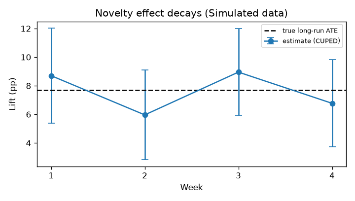

# Experimentation: suggested actions in the review flow

> **All data are simulated.** A seeded generator stands in for reviewers and their cases; there
> are no real users, reviewers or production traffic. Because the simulator knows the true effect,
> every method below is scored against ground truth.

This module answers one product question with an A/B test and then scores the statistics against
the simulator's ground truth. The question: does showing ranked suggested actions in the review queue
raise action conversion without hurting quality? It lives in `src/d2d/experiment/` and runs with
`d2d experiment`.

- [Pre-registration](experiment-preregistration.md), committed before the pre-registered seed was run
- [Decision memo](experiment-decision-memo.md), one page
- [Full results](experiment/results.md) and [machine-readable results](experiment/results.json)

## Reproduce

```bash
uv sync --group experiment                       # adds econml + matplotlib (optional group)
uv run d2d simulate --data-dir data/check && uv run d2d run --data-dir data/check   # case templates
uv run d2d experiment power  --data-dir data/check
uv run d2d experiment report --data-dir data/check          # ~40 s, ~0.6 GB peak RSS on an M4
# single steps
uv run d2d experiment simulate --design reviewer --seed 20261113 --data-dir data/check
uv run d2d experiment analyze --in data/experiment/reviewer
uv run d2d experiment aa-test --sims 300
uv run d2d experiment simulate --design reviewer --srm-bug --out data/experiment/srm
```

All commands take `--seed`. The report is deterministic: re-running it reproduces
`docs/experiment/results.json` exactly.

## The simulator

`d2d experiment simulate` draws cases by resampling the pipeline's stories. Each story keeps its
category, device kind and severity, and its label comes from the simulated reviewer
(`d2d.hitl.sim_reviewer`). The cases are assigned to 120 simulated reviewers over 28 days. All
parameters are in `config/experiment.toml`:

| Ingredient | What it is for |
|---|---|
| Heterogeneous effect | The true lift depends on device group, severity and reviewer experience (junior reviewers gain more) |
| CUPED covariate | Each reviewer's pre-period conversion rate is correlated with their latent propensity |
| Novelty | The effect is 50 % higher on day 0 and decays with a 5-day time constant |
| Spillover | Under case randomization, 40 % of the effect leaks into the reviewer's control cases (learning) |
| Guardrails | Followed wrong suggestions create wrong actions; suggestions lower false escalation of `info` cases |
| SRM bug (optional) | Half of the slow treatment cases (> 30 min) are not logged |
| Observational mode | Reviewers choose suggestions based on experience, past conversion and severity. An unrelated "history panel" has zero effect but is confounded |

## Methods

| Step | Implementation |
|---|---|
| Power / MDE | Normal-approximation MDE with a design effect `1 + (m-1) ICC`. ICC comes from a one-way ANOVA on a pre-period A/A simulation; CUPED shrinks variance by `1 - R²` |
| SRM | Chi-square on case counts, plus a Welch test on cases per reviewer (cluster design); p < 0.001 |
| Effect | Difference in means with Welch SE (case design) or cluster-robust CR1 SE by reviewer and t with G-1 df (reviewer design) |
| CUPED | `y - θ(x - x̄)`, θ pooled, same SEs |
| Multiple testing | Holm on {primary, resolve time, wrong action, false escalation}; Benjamini-Hochberg reported |
| Guardrails | Non-inferiority: upper 95 % bound of the increase < 1.0 pp |
| Sequential | Two-sided O'Brien-Fleming boundaries at 4 weekly looks, found by Monte Carlo on Brownian motion (seeded) |
| Peeking | A/A Monte Carlo: naive "stop at first p < 0.05" vs fixed horizon vs OBF |
| HTE | EconML `CausalForestDML` (honest, 400 trees) with a known 50/50 propensity, out-of-fold by reviewer (5 folds). Validated against the true per-case effect: correlation, segment errors, interval coverage, calibration by predicted quintile and a BLP slope |
| Confounding | Naive vs OLS adjustment vs cross-fitted AIPW vs causal-forest ATE, cluster SEs by reviewer |

## Key results (pre-registered seed 20261113)

Ground truth: long-run ATE **+7.70 pp**. Over the 28-day window, which includes novelty, it is
**+8.48 pp**. The baseline conversion is 29.4 %.



| Design | Estimator | Estimate | 95 % CI | SE |
|---|---|---:|---:|---:|
| reviewer (primary) | difference in means | +5.93 pp | [+1.77, +10.10] | 2.10 pp |
| reviewer (primary) | **CUPED** | **+7.62 pp** | [+5.42, +9.82] | 1.11 pp |
| case (comparison) | CUPED | +4.74 pp | [+3.32, +6.17] | 0.73 pp |

- **CUPED** cut the variance of the reviewer-design estimate by **72 %**. It also lowered the ICC
  from 0.068 to 0.006, which brought the MDE from 6.38 pp down to 2.63 pp.
- **Interference:** the case-randomized test is tighter, but it misses the truth (+4.74 pp vs +7.70 pp)
  because of the spillover into control cases. Its CI excludes the true effect.
- **Guardrails:** wrong actions rose by **+1.02 pp** (1.27 % → 2.29 %, upper bound +1.50 pp). That
  **fails** the 1 pp margin. False escalation fell by 1.25 pp (pass). Time to resolve showed no
  significant change (-0.73 min, Holm p = 0.44).
- **Decision (pre-registered rule): iterate.** See the [memo](experiment-decision-memo.md).

### Validity checks



| Check | Result |
|---|---|
| Peeking, 4,000 A/A runs with 10 looks | False positives 0.056 at a fixed horizon, **0.205** when stopping at the first p < 0.05, **0.059** with O'Brien-Fleming |
| Simulator A/A, 300 runs (MC SE 0.013) | Reviewer design with iid Welch SE: **0.517**. Cluster-robust: **0.043**. Cluster + CUPED: 0.077. Case design: 0.057 |
| SRM bug | 856 cases dropped, so χ² p = 3e-10 and the per-reviewer p = 1.4e-8 flag it. The clean run has p = 0.61. Without the check, the bug would have reported resolve time as -3.60 min instead of -0.73 min |
| O'Brien-Fleming on the real run | z = 5.18 at day 7 vs boundary 4.01, so the test would have stopped at the first look |

Ignoring clustering in the reviewer design gives a 52 % false-positive rate; that number is the
reason the primary analysis uses cluster-robust SEs.

### Heterogeneous effects (causal forest)



On the pre-registered reviewer-randomized run, the forest recovered the **ranking by experience**
well: junior/mid/senior came out at 11.2/7.7/5.4 pp, against a truth of 11.9/8.6/5.0 pp. It
**shrank the device-group and severity differences** toward the mean. For example, `alert` was
estimated at 6.1 pp against a truth of 1.3 pp. Its individual CATEs were weak overall:

| Metric | Value |
|---|---:|
| Correlation with true CATE | 0.35 |
| RMSE vs true CATE SD | 6.7 pp vs 5.1 pp |
| 90 % interval coverage | 0.62 |
| BLP calibration slope | -0.26 (95 % CI -2.07 to 1.55) |

This result is **not good enough to target suggestions by individual CATE**. With 120 reviewer
clusters, reviewer-level noise dominates; segment-level estimates are the usable output. The unit
test runs a cleaner setting (case randomization, no spillover, development seed 7). There the forest
passes r > 0.5, a mean error < 1 pp, segment errors < 4.5 pp and a calibration slope in [0.5, 1.5].
That setting shows the estimator works when the signal is there; it is not the pre-registered result.

### Confounding demo (observational data)



| Exposure | Truth | Naive | OLS | AIPW | Causal forest |
|---|---:|---:|---:|---:|---:|
| Suggestions | +7.70 pp | +14.02 pp | +7.82 pp | +7.84 pp | +7.94 pp |
| History panel (no effect) | 0.00 pp | **+5.56 pp** | -0.37 pp | -0.67 pp | -0.32 pp |

When reviewers choose the feature themselves, the naive comparison nearly doubles the effect. It
also "finds" a 5.6 pp effect for a panel that does nothing. All three adjusted estimators cover the
truth, but only because every confounder is observed by construction.

### Novelty



Weekly CUPED effects were +8.7, +6.0, +9.0 and +6.8 pp. The weeks 3–4 estimate was +7.88 pp
[+5.50, +10.27], above the 2 pp practical threshold. The simulated novelty adds only about 0.8 pp
over the whole window, which is well below the weekly SE (~1.7 pp). The test cannot resolve the
decay, and these figures do not claim to show it.

## Limitations

- **Simulated data.** The effect sizes, ICC and novelty come from `config/experiment.toml`, not from
  measurements. The work demonstrates methods and validates them against a known truth. It says
  nothing about real reviewers.
- **Unconfoundedness holds by construction** in the observational demo. Real observational data
  have unobserved confounders that no estimator here can fix.
- **Small number of clusters (120).** CR1 with t at G-1 df held the A/A false-positive rate at
  0.043. With CUPED it reached 0.077 (± 0.013), slightly anti-conservative, likely because θ is
  estimated. Wild-cluster bootstrap would be a better check. It does not change this decision
  (primary p = 3e-10).
- **Causal-forest intervals under-cover** (0.62 for a nominal 0.90), and the forest's ATE SE ignores
  clustering. The AIPW cluster SE is the reference in the confounding demo.
- **The power formula** uses a normal approximation with a constant design effect. Cluster-size
  variation is ignored.
- **Spillover is a single parameter.** Real interference structures (shared queues, team norms) are
  richer.

## Deviations from the pre-registration

- The report's power table first used the realized experiment's case count (8,314 per arm). The
  pre-registration used the pre-period count (8,413). The report was switched to the pre-period
  count so it matches the pre-registration; the MDEs move by ≤ 0.01 pp. No estimate, test or
  decision changed.
- Bug fix (2026-11-21): the OLS adjustment in the confounding demo puts an intercept next to a full
  set of one-hot dummies, so `XᵀX` is singular. The cluster-robust SE used a plain inverse, which
  gave platform-dependent standard errors (a negative variance on Linux CI). It now uses a
  pseudo-inverse with the true rank. The OLS estimates are unchanged. The OLS 95 % CI for
  suggestions widened from [+6.58, +9.05] to [+6.37, +9.27] pp and still covers the truth. All other
  results are identical.
