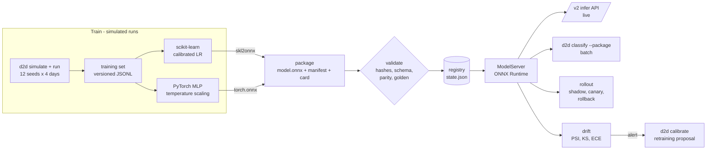

# Model serving (M16)

All data on this page is simulated by the seeded household simulator. Numbers come from one run on a
Mac mini (Apple M6, 1 ONNX Runtime thread) on 2026-11-21. They are reproducible with the commands
below; latency will differ on other hardware.

## What it does

The story classifier is exported to ONNX, packaged with a manifest, and served the same way for
nightly batches (`d2d classify --package`) and live requests (Open Inference Protocol v2, the
KServe/Triton REST protocol). New versions go through a validation gate, shadow traffic and canary
steps, with automatic rollback. A drift monitor compares a traffic window with a reference window
and can write a retraining proposal through `d2d calibrate`. The format is described in
[ADR 0003](adr/0003-model-package-format.md).



## Commands

Install the optional group once (Python 3.12 to 3.14; onnxruntime has no 3.15 wheel yet):

```sh
uv sync --group serving
uv run d2d model package --framework sklearn      # or pytorch
uv run d2d model validate models/registry/packages/story-classifier/<version>
uv run d2d model rollout <version>                # first rollout makes it stable
uv run d2d model rollout <other-version>          # gate -> shadow -> canary -> promote/rollback
uv run d2d model status
uv run d2d model serve --port 8100                # v2 API on 127.0.0.1
uv run d2d model bench                            # -> data/serving/bench.json
uv run d2d model drift --shift none|linking_bug|category_mix [--propose]
uv run d2d classify --package models/registry/packages/story-classifier/<version>
```

To mount the v2 routes on the main API, set `D2D_MODEL_REGISTRY=models/registry`. The routes are
then served under `/v2` behind the same access dependency (`get_scope`) as the other API routes:
without a session they return 401 when login is on.

Registry, runs, training sets and bench results are gitignored (`models/`, `data/`).

## Packages

| | scikit-learn | PyTorch MLP |
|---|---|---|
| Version | `clf-e8162317c8` | `mlp-15a5067012` |
| Model | logistic regression, sigmoid calibration (in the graph) | 126 -> 64 -> 14, ReLU, temperature 0.25 |
| Training data | 266 stories from 12 simulated runs | same |
| `model.onnx` | 48 KB | 44 KB |
| Golden coverage / min precision (23 stories) | 1.000 / 1.000 | 1.000 / 1.000 |
| Parity, max abs prob diff (289 stories) | 1.09e-07 | 2.20e-13 |
| Native vs ONNX decisions identical | yes | yes |
| `validate` | PASS | PASS |

A package trained with 50% random labels (`--label-noise 0.5`, version `clf-555063e4e5`) scores
golden coverage 0.000, fails `validate`, and is rejected at the rollout gate.

## Latency and throughput

`d2d model bench`. In-process numbers time vectorize + predict + decide, one ONNX Runtime thread.
HTTP numbers are from a separate `d2d model serve` process on localhost.

| Path | Batch | p50 ms | p95 ms | p99 ms | rows/s | Peak RSS |
|---|---|---|---|---|---|---|
| In-process, native PyTorch | 1 | 0.014 | 0.022 | 0.028 | 64,486 | 467 MB |
| In-process, native PyTorch | 64 | 0.216 | 0.241 | 0.347 | 290,541 | 467 MB |
| In-process, ONNX Runtime | 1 | 0.009 | 0.026 | 0.040 | 79,340 | 174 MB |
| In-process, ONNX Runtime | 64 | 0.353 | 0.493 | 0.561 | 174,679 | 174 MB |
| HTTP v2, 1 client | 1 | 0.53 | 0.99 | 1.55 | 1,620 | |
| HTTP v2, 1 client | 64 | 2.15 | 4.78 | 5.38 | 25,637 | |
| HTTP v2, 8 clients | 1 | 2.21 | 5.01 | 7.65 | 3,060 | |

All targets in `config/serving.toml` passed: in-process p95 under 2 ms, HTTP p50/p95/p99 under
10/20/50 ms, more than 2,000 rows/s at batch 64, and 0 errors (target ≤ 0.1%).
The ONNX Runtime process needs 63% less memory than the PyTorch process (174 vs 467 MB).
It is not faster at batch 64 here (175k vs 291k rows/s, both measured at about 1 CPU core).
The benchmark did not investigate why.

## Rollout

`d2d model rollout` sends simulated, labeled traffic through the same `ModelServer` the API uses.
Canary routing hashes the request id, so a retried request takes the same route. The guardrails
per step are: candidate error rate ≤ 1%, p95 ≤ 20 ms, precision on labeled routed traffic ≥ 0.9,
shadow agreement ≥ 0.8, and the routed count must match the step weight.

| Scenario | Outcome | Where it stopped |
|---|---|---|
| First package (`clf-e8162317c8`) | initial | becomes stable |
| PyTorch MLP as candidate | promoted | shadow 400 requests, agreement 1.000; canary 5/25/50/100% (18/99/207/400 candidate requests), precision 1.000, 0 errors |
| sklearn candidate with 5% injected errors | rolled back | shadow: error rate 0.060 > 0.01 |
| Same, `--skip-shadow` | rolled back | canary 5%: error rate 0.048 > 0.01 (21 requests) |
| 50% label noise package | rejected | gate: golden coverage 0.0 < 0.7 |

Fault injection (`--inject-errors`) is a demo flag. It only exists in the rollout command, not in
`d2d model serve`.

## Drift

`d2d model drift` scores 6 simulated traffic runs as the reference (138 stories) and 6 later runs
as the window (138 stories), with an optional injected shift. It checks feature-presence PSI,
unseen features, label-mix PSI, a KS test on top-class confidence, and ECE.

| Shift | Max feature PSI | Prediction PSI | Confidence KS p | Accuracy | Alert |
|---|---|---|---|---|---|
| none | 0.000 | 0.000 | 1.0 | 1.000 -> 1.000 | no |
| linking_bug (link reasons dropped) | 2.130 (`reason=device`) | 0.000 | 0.68 | 1.000 -> 1.000 | input drift |
| category_mix (rarest category x3 traffic) | 2.455 | 2.455 | 0.87 | 1.000 -> 1.000 | input + prediction drift |

With `--propose`, an alert runs `d2d calibrate` on the latest traffic run and adds a
"Serving drift" section to its report. Like every calibration proposal, it needs a human to
approve it.

## Limitations

- **The golden gate is a regression check, not a generalization estimate.** The simulator's
  scenario plan is fixed; seeds only change noise. All 23 golden stories have an exact
  feature-and-label duplicate in the training runs, so golden coverage and precision of 1.000 say
  nothing about unseen households. The same applies to rollout precision on simulated traffic.
- The no-shift drift result (all zeros) is trivially true for the same reason: the reference and
  window runs have the same scenarios. It shows there are no false alarms on identical
  distributions, not on realistic week-to-week variation.
- The linking-bug shift is detected as input drift, but accuracy does not drop. The classifier does
  not rely on link reasons. This is a correct alert for an upstream change with no accuracy impact.
- The two frameworks calibrate differently, so their thresholds are not comparable. The sklearn
  baseline keeps the existing M7 method (out-of-fold on augmented data, not grouped by story). The
  MLP uses folds grouped by story, and its temperature reached the edge of the search grid (0.25).
- In-process rollout and drift run in one process on simulated traffic. There is no load balancer,
  no multi-replica state and no persistent metrics store; `/v2/stats` is in memory.
- Not run: KServe, Triton, a kind/Kubernetes cluster, or GPU inference. The v2 protocol is
  implemented in-repo and tested with FastAPI's test client and a local server only.
